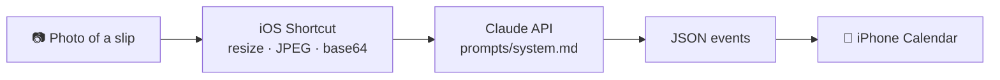
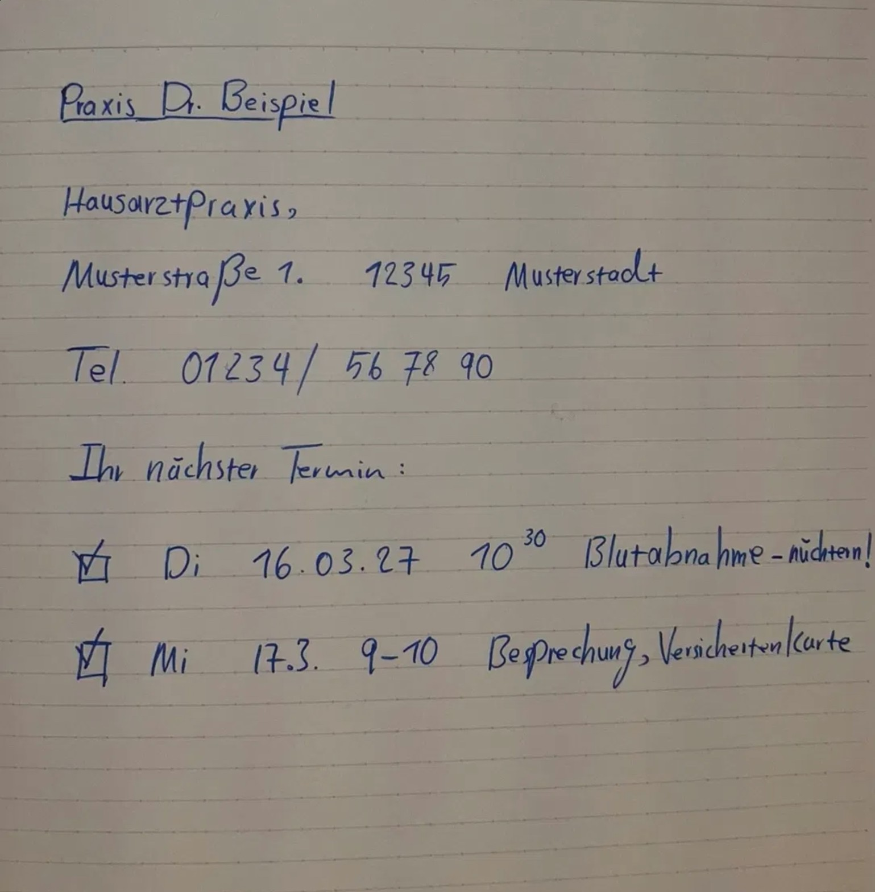

# paper2cal

**Photograph a paper appointment slip, get an iPhone calendar entry.**

German doctors' practices still hand out handwritten appointment slips ("Terminzettel").
paper2cal turns a photo of one into calendar events: an iOS Shortcut sends the photo to
Claude (Anthropic's multimodal LLM), which returns the appointments as structured JSON, and
the Shortcut writes them to the calendar — title, time, address, preparation notes and a reminder.



## Example

This handwritten slip ([`examples/beispiel-handschrift.jpg`](examples/beispiel-handschrift.jpg),
fictional data) …



… becomes two calendar events:

```json
{
  "events": [
    {
      "title": "Blutabnahme – Dr. Beispiel",
      "start": "2027-03-16 10:30",
      "end": "2027-03-16 11:00",
      "location": "Praxis Dr. Beispiel, Musterstraße 1, 12345 Musterstadt",
      "notes": "Blutabnahme\nnüchtern kommen\nTel. 01234/567890",
      "confidence": "high",
      "warning": ""
    },
    {
      "title": "Besprechung – Dr. Beispiel",
      "start": "2027-03-17 09:00",
      "end": "2027-03-17 10:00",
      "location": "Praxis Dr. Beispiel, Musterstraße 1, 12345 Musterstadt",
      "notes": "Besprechung\nVersichertenkarte mitbringen\nTel. 01234/567890",
      "confidence": "high",
      "warning": ""
    }
  ]
}
```

Note what the model had to work out: the superscript minutes in `10³⁰`, the missing year in
`17.3.` (resolved to the next occurrence), the time window `9–10`, and a cross-check of each
date against the ticked weekday.

## How it works

| Part | What it does |
|---|---|
| [`prompts/system.md`](prompts/system.md) | The extraction rules: German date formats, year inference, weekday cross-check, ditto marks, grouping ticked items, short titles, warnings only when a date or time might be wrong. Output is a strict JSON contract. |
| [`extract.py`](extract.py) | Sends one photo to the API, prepared exactly like the phone does (upright, max 1568 px, JPEG). |
| [`evaluate.py`](evaluate.py) | Runs every photo in a folder against an answer key (`expected.json`) and scores start/end times, required words, forbidden phrases and title length. Logs each run per prompt version. |
| [`build_request.py`](build_request.py) | Generates the Shortcut's request body **from the same prompt files the tests use**, so the phone always sends a tested prompt. `--test` sends it once over plain HTTP, parsing the answer the way the Shortcut does. |
| [`shortcut/`](shortcut/) | The exported iOS Shortcut (no API key inside). |

## Evaluation

The prompt was developed against a private test set of **6 real slips with 7 appointments**
(not published: they are a family member's medical appointments). It covers the hard cases:
handwriting on printed forms, missing years, ticked weekdays, superscript minutes, time windows,
ditto marks, several ticked items sharing one slot, one circled doctor among several names, and
half-visible slips at the edge of the photo that must be ignored.

| Prompt version | Photos passing | Events with warning | Notes |
|---|---|---|---|
| v1 (baseline) | 4/6 | 2 | All dates and times already correct; titles too long, warnings for routine assumptions |
| v2, run 1 | **6/6** | **0** | Short titles, warnings only when a date/time might be wrong, glossary; ~23 % fewer output tokens |
| v2, run 2 | **6/6** | **0** | Repeated to check consistency (model output is not deterministic) |

The public example in [`examples/`](examples/) passes as well. Answer keys can pin "today"
(`"_today"` in `expected.json`), so slips without a year resolve the same way whenever the test runs.

## Setup

Requires Python 3.10+ (developed on 3.13) and an [Anthropic API key](https://platform.claude.com).

```bash
git clone https://github.com/realmosn/paper2cal.git
cd paper2cal
python3 -m venv .venv && source .venv/bin/activate
pip install -r requirements.txt
cp .env.example .env              # then put your API key into .env

python evaluate.py --samples examples           # score the public example
python extract.py examples/beispiel-handschrift.jpg   # print the extracted events
```

To build your own test set, put photos and an `expected.json` into `samples/` (git-ignored) and
run `python evaluate.py`. Use `--cached` to re-score saved results without calling the API.

## iPhone Shortcut

1. Get [`shortcut/Termin scannen.shortcut`](shortcut/) onto your iPhone (AirDrop or iCloud Drive) and tap **Add Shortcut**.
2. Open it in the editor and replace `PASTE-KEY-HERE` in the first Text action with your API key.
3. In **Add New Event**, choose the calendar the appointments should go to.
4. Start it from the home screen, Back Tap or the Action Button (camera), or share several photos to it from the Photos app.

Events with a `warning` get ⚠️ in their title and the reason at the top of the notes.

**Changing the prompt:** edit `prompts/system.md`, run `python evaluate.py` until it passes, then
`python build_request.py` and paste `out/shortcut_body.txt` over the template Text action in the
Shortcut. The `@@TODAY@@` and `@@IMAGE@@` placeholders are filled in at runtime.

## Privacy and security

- **Photos are sent to the Anthropic API** for processing. Review Anthropic's terms before using it with sensitive documents.
- **Image metadata is stripped** before upload (the Shortcut converts with *Preserve Metadata* off; `extract.py` re-encodes the image).
- **One API key per device**, with a spend limit, so a lost phone means revoking one key.
- **No secrets or personal data in this repository**: `.env`, `samples/` and `out/` are git-ignored, the Shortcut is exported without its key, and the history was audited for keys and personal data before publishing.

## Limitations

- Built for **German** appointment slips; other languages would need prompt changes and their own test set.
- Six real slips are enough to develop a prompt, not to claim general accuracy. **Check important appointments.**
- Not medical software.

## License

[MIT](LICENSE)
